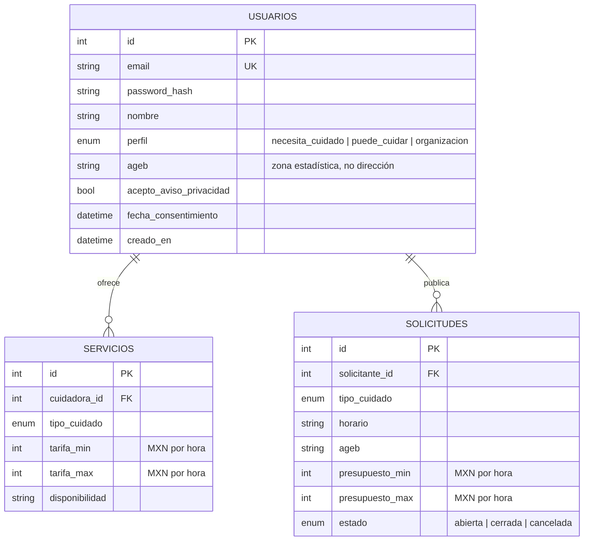

# Modelo de datos (Paso 2)

Las tablas de vinculaciones, horas, pagos simulados, evaluaciones e incidentes se agregan en los Pasos 3 y 4.

## Decisiones de diseño y privacidad

- **Zona por AGEB, no por dirección:** minimiza los datos personales y permite marcar zonas prioritarias.
- **Sin datos de salud ni diagnósticos:** solo el tipo de cuidado que se necesita u ofrece.
- **Consentimiento registrado:** se guarda si la persona aceptó el aviso de privacidad y la fecha.
- **Contraseñas:** nunca se guardan; se almacena un hash con scrypt y sal aleatoria.
- **Rangos de precio:** una restricción de base de datos impide que el máximo sea menor que el mínimo.
- **Género:** no se guarda ni se usa como criterio de elegibilidad.

## Endpoints disponibles

| Método | Ruta | Descripción |
|---|---|---|
| POST | `/auth/registro` | Crea una cuenta (exige aceptar el aviso de privacidad). |
| POST | `/auth/login` | Devuelve un token de acceso. |
| GET | `/auth/yo` | Datos de la persona autenticada (requiere token). |
