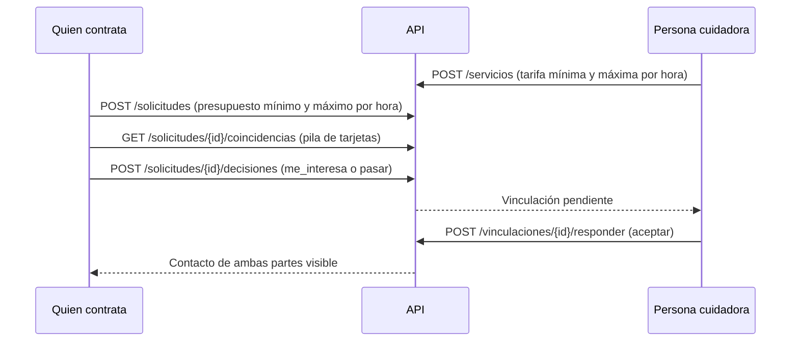

# Matching y deslizamiento (Paso 3)

## Flujo

## Cómo se calcula la compatibilidad (0 a 100)

El tipo de cuidado se filtra primero. Después, una persona cuidadora **queda fuera** si está en otra alcaldía o si su rango de tarifa no se traslapa con el presupuesto.

| Criterio | Caso | Puntos |
|---|---|---|
| Tipo de cuidado | Coincide (siempre, es un filtro) | 20 |
| Zona | Misma AGEB | 40 |
| Zona | Misma alcaldía, otra AGEB | 25 |
| Zona | Falta el dato de alguna de las dos | 10 |
| Precio | La tarifa máxima cabe en el presupuesto | 40 |
| Precio | Los rangos se traslapan, pero la tarifa máxima supera el presupuesto | 25 |

Cada tarjeta devuelve el puntaje y la lista de criterios, para poder **explicar por qué coincide**. Los pesos están como constantes en `backend/app/matching.py` y se pueden ajustar.

## Reglas del deslizamiento

- **Derecha ("me_interesa"):** crea una vinculación en estado pendiente. No se comparte ningún contacto.
- **Izquierda ("pasar"):** el perfil no vuelve a aparecer en esa solicitud.
- No se puede decidir dos veces sobre el mismo perfil.
- La persona cuidadora acepta o rechaza. **Solo al aceptar** se muestra el correo de la otra persona.
- Las tarjetas no incluyen correo, solo nombre, tipo de cuidado, rango de tarifa, disponibilidad, puntaje y criterios.
- Si la AGEB de la solicitud está en la lista de zonas prioritarias (`AGEBS_PRIORITARIAS` en `.env`), las tarjetas llevan `zona_prioritaria: true`. Esa lista viene de los hallazgos del Observatorio.

## Endpoints nuevos

| Método | Ruta | Quién | Descripción |
|---|---|---|---|
| POST | `/servicios` | Persona cuidadora | Publica un servicio con rango de tarifa. |
| GET | `/servicios/mios` | Persona cuidadora | Lista sus servicios. |
| POST | `/solicitudes` | Quien contrata | Publica una solicitud con presupuesto por hora. |
| GET | `/solicitudes/mias` | Quien contrata | Lista sus solicitudes. |
| GET | `/solicitudes/{id}/coincidencias` | Quien contrata | Pila de tarjetas, de mayor a menor compatibilidad. |
| POST | `/solicitudes/{id}/decisiones` | Quien contrata | Desliza: `me_interesa` o `pasar`. |
| GET | `/vinculaciones/recibidas` | Persona cuidadora | Solicitudes de contacto recibidas. |
| GET | `/vinculaciones/mias` | Quien contrata | Solicitudes de contacto enviadas. |
| POST | `/vinculaciones/{id}/responder` | Persona cuidadora | Acepta o rechaza. |

## Limitaciones conocidas

- **La zona se compara con la clave AGEB:** misma clave o mismo prefijo de alcaldía. Todavía no se mide la distancia real de 1 km del Observatorio; eso requiere coordenadas y se puede agregar después.
- **La disponibilidad es texto libre** y por ahora no entra en el puntaje.
- **El puntaje es una regla explicable, no un modelo de aprendizaje automático.** Un modelo entrenado con datos de uso se puede evaluar más adelante.
- Los perfiles y las solicitudes de ejemplo son sintéticos.
