# Evidencias del Paso 3: registro, matching y contacto

Prueba hecha en `http://localhost:8000/docs` (documentación interactiva de la API), con dos cuentas de ejemplo: una persona cuidadora (Ana) y una familia que contrata (Familia Lopez). Todos los datos son de ejemplo y los tokens de las capturas son de una prueba local que ya venció.

| N.º | Captura | Qué demuestra |
|---|---|---|
| 01 | `01-registro-cuidadora.png` | Registro de la persona cuidadora (201). La respuesta no incluye la contraseña. |
| 02 | `02-registro-familia.png` | Registro de la familia con perfil `necesita_cuidado` (201). |
| 03 | `03-login-cuidadora.png` | Inicio de sesión y token de acceso (200). |
| 04 | `04-servicio-cuidadora.png` | La cuidadora publica un servicio con rango de tarifa de $100 a $130 por hora (201). |
| 05 | `05-regla-rango-precio.png` | La API rechaza una tarifa máxima menor que la mínima (422). |
| 06 | `06-solicitud-familia.png` | La familia publica una solicitud con presupuesto de $90 a $130 por hora (201). La zona se toma de su cuenta. |
| 07 | `07-tarjeta-puntaje.png` | Tarjeta de coincidencia con puntaje 100 y criterios de tipo de cuidado, zona y precio. No incluye datos de contacto. |
| 08 | `08-deslizar-me-interesa.png` | Deslizar a la derecha (`me_interesa`) crea una vinculación pendiente (201). |
| 09 | `09-pila-vacia.png` | Después de decidir, el perfil ya no aparece en la pila de tarjetas. |
| 10 | `10-permiso-por-perfil.png` | Una familia no puede ver las solicitudes recibidas de una cuidadora (403). |
| 11 | `11-contacto-oculto.png` | Antes de aceptar, la vinculación está pendiente y el contacto es `null`. |
| 12 | `12-contacto-visible.png` | La cuidadora acepta y se muestra el contacto de la familia. |

## Imágenes

### 01. Registro de la cuidadora
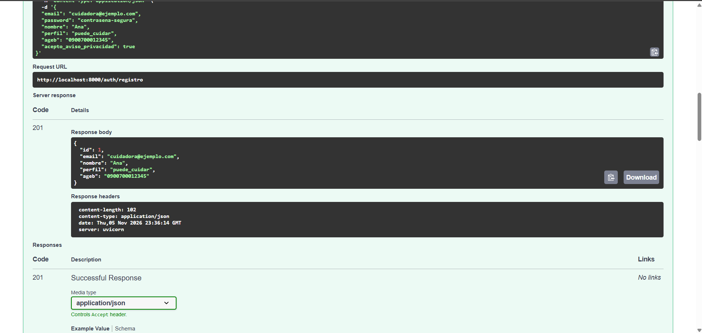

### 02. Registro de la familia
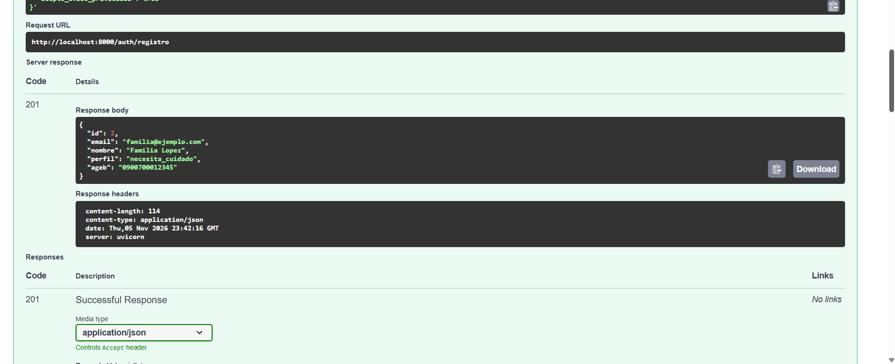

### 03. Inicio de sesión
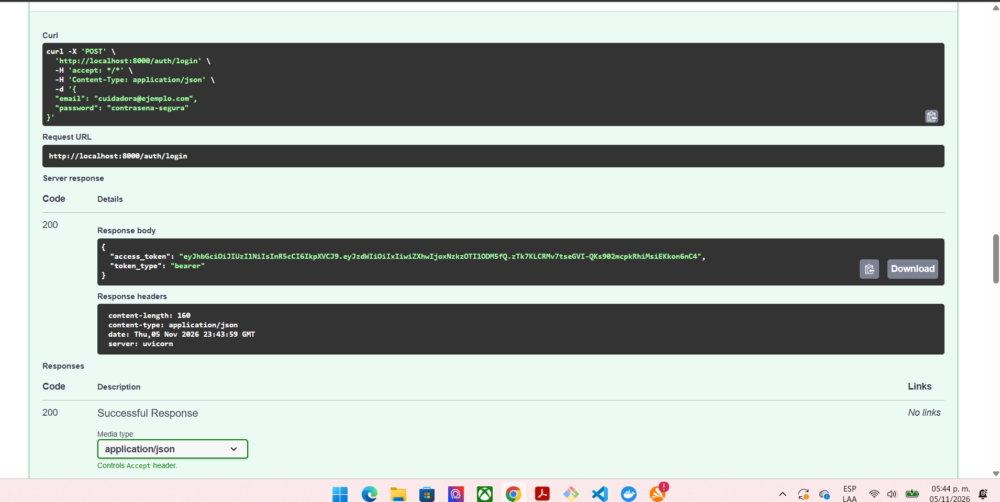

### 04. Servicio publicado con rango de tarifa
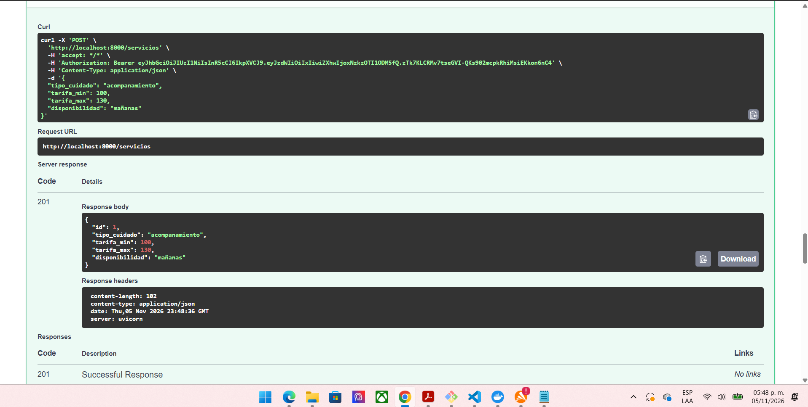

### 05. Regla del rango de precio
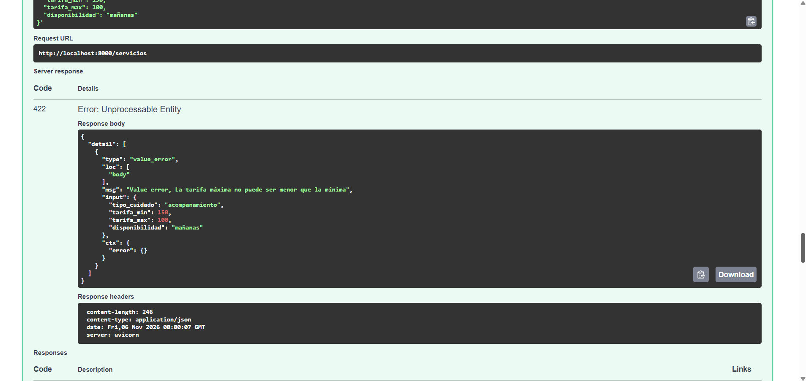

### 06. Solicitud publicada con presupuesto
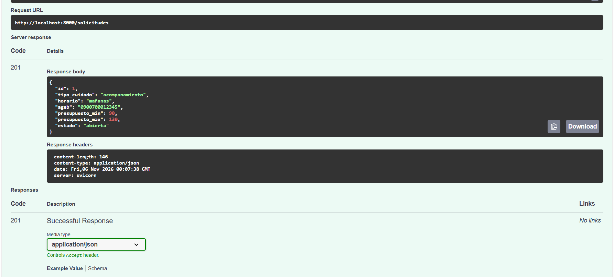

### 07. Tarjeta con puntaje de compatibilidad
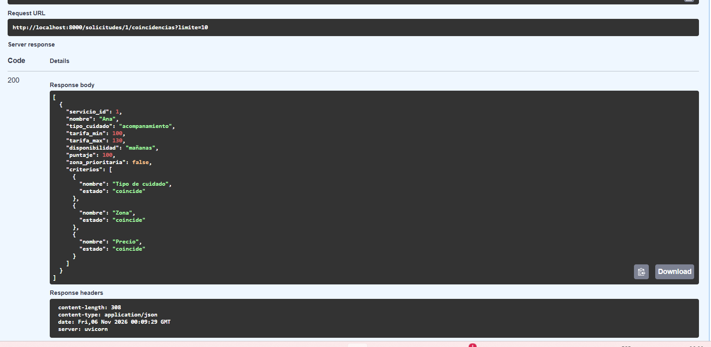

### 08. Deslizar a la derecha
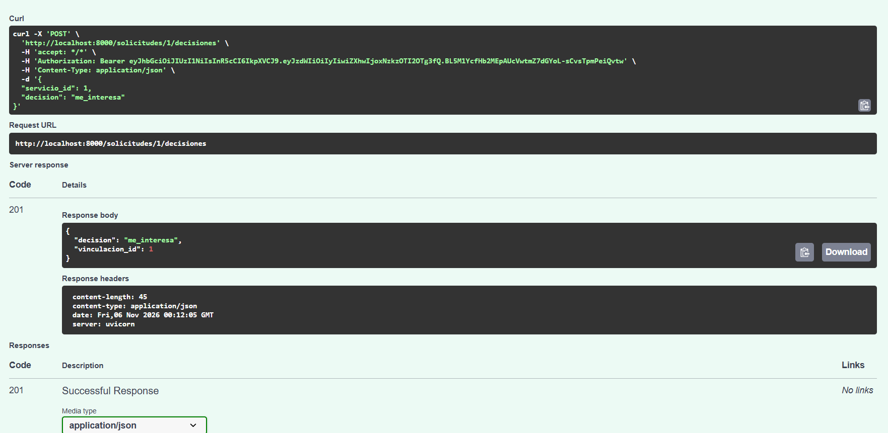

### 09. Pila vacía después de decidir
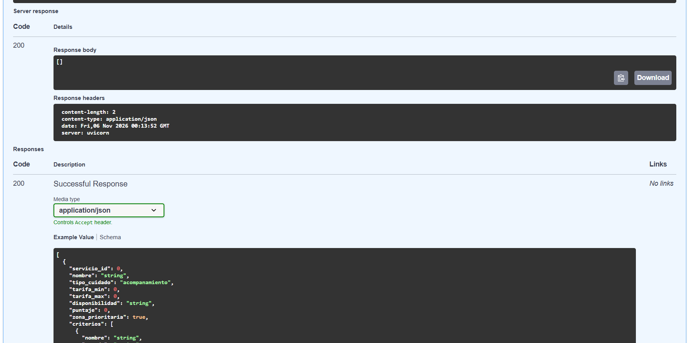

### 10. Permiso por perfil
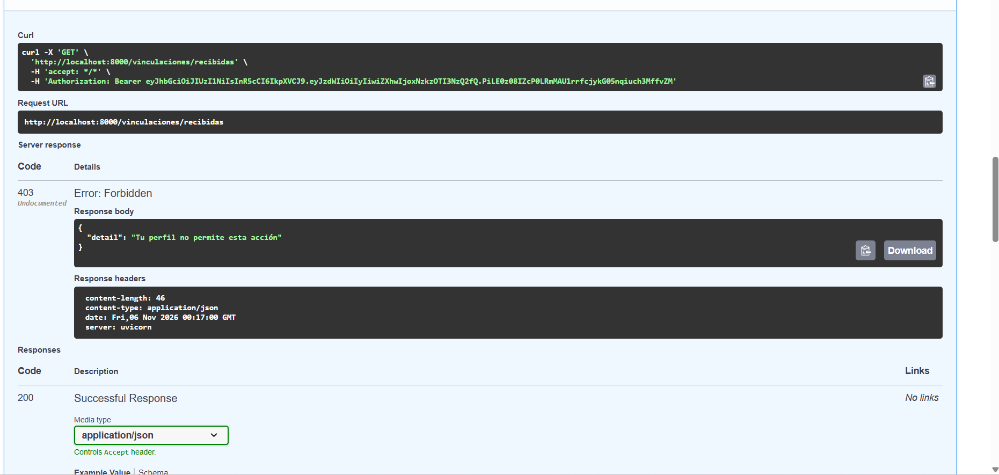

### 11. Contacto oculto antes de aceptar
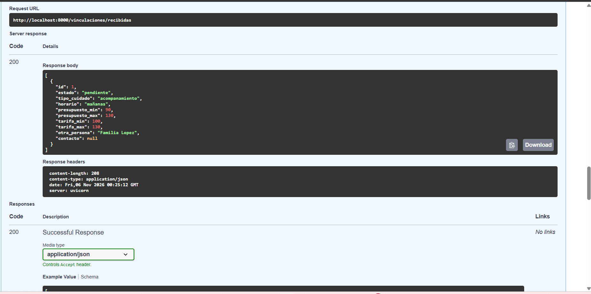

### 12. Contacto visible después de aceptar
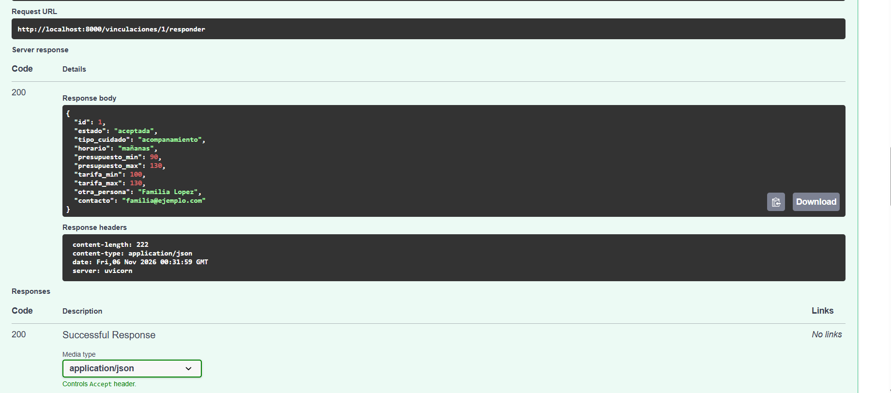
